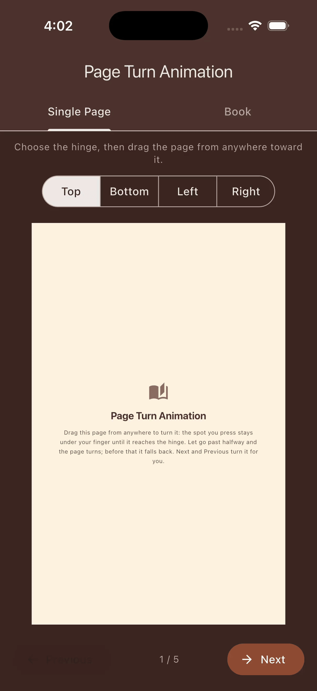
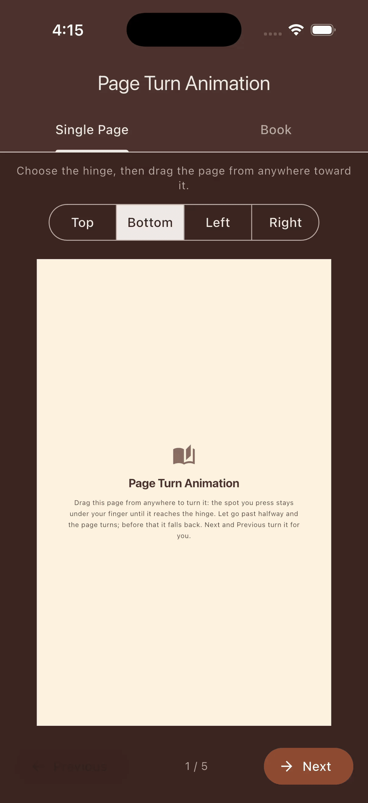
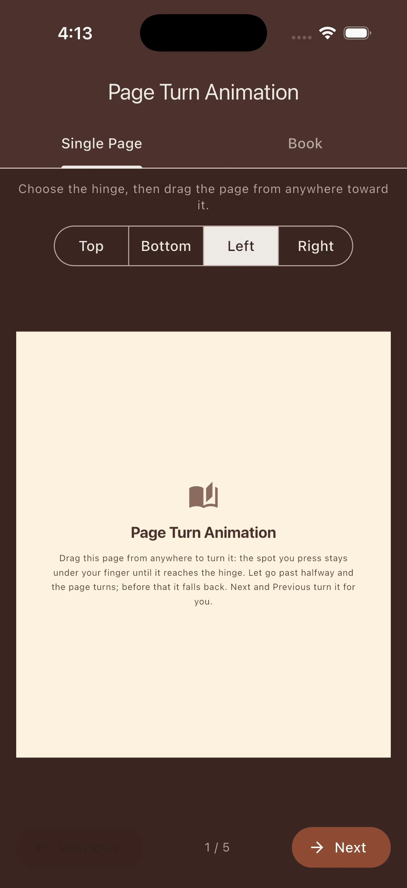
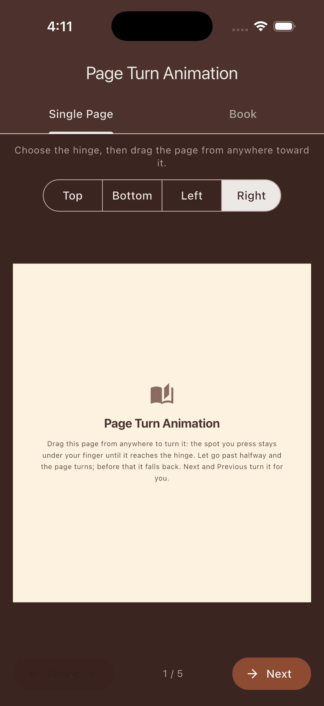
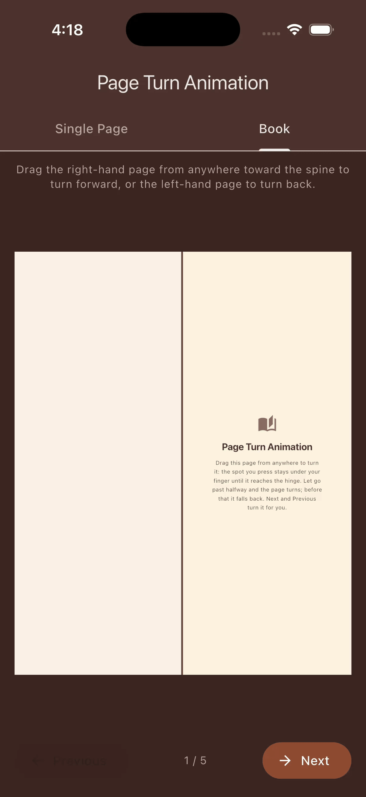

# Page Turn Animation

A Flutter package that provides a realistic page turn/curl animation effect for transitioning between content.

[](https://pub.dev/packages/page_turn_animation)
[](https://opensource.org/licenses/MIT)
[](https://pub.dev/publishers/resengi.io)


<table>
  <tr>
    <td></td>
    <td></td>
    <td></td>
    <td></td>
  </tr>
  <tr>
    <td align="center">Top</td>
    <td align="center">Bottom</td>
    <td align="center">Left</td>
    <td align="center">Right</td>
  </tr>
</table>

<table>
  <tr>
    <td></td>
    <td></td>
    <td></td>
  </tr>
  <tr>
    <td align="center">Book (180°, back image)</td>
    <td align="center">Drag from anywhere</td>
    <td align="center">Drag a page back</td>
  </tr>
</table>

## Features

- Realistic 3D page curl effect
- Smooth, performant animations
- Fully customizable styling
- Works with any Flutter widget content
- Support for forward and backward page turns
- Control which edge the page curls over (top, bottom, left, right)
- Choose the surface the turned page lies down on, from beside the stack to the back of it
- Turn the page from any point on it, not only its edge
- Show an image on the back of the page, or a plain color
- Drive the turn with a drag, keeping the pressed spot under the finger
- Shadows as from a lamp over the hinge: the page's shadow on what it covers and on itself, and its shading

## Installation

Add the package to your `pubspec.yaml`:

```yaml
dependencies:
  page_turn_animation: ^0.1.4
```

Then run:

```bash
flutter pub get
```

## Quick Start

```dart
import 'package:page_turn_animation/page_turn_animation.dart';

// In your widget with an AnimationController:
PageTurnAnimation(
  image: capturedImage,
  animation: animationController,
  direction: PageTurnDirection.forward,
)
```

## Usage Guide

### Capturing Widget Content

The page turn animation works with `ui.Image` objects. You'll need to capture your widget content first:

```dart
import 'dart:ui' as ui;
import 'package:flutter/rendering.dart';

class MyAnimatedWidget extends StatefulWidget {
  @override
  State<MyAnimatedWidget> createState() => _MyAnimatedWidgetState();
}

class _MyAnimatedWidgetState extends State<MyAnimatedWidget>
    with SingleTickerProviderStateMixin {
  final GlobalKey _repaintKey = GlobalKey();
  late AnimationController _controller;
  ui.Image? _capturedImage;

  @override
  void initState() {
    super.initState();
    _controller = AnimationController(
      duration: const Duration(milliseconds: 600),
      vsync: this,
    );
  }

  Future<void> _captureWidget() async {
    final boundary = _repaintKey.currentContext!.findRenderObject()
        as RenderRepaintBoundary;
    final pixelRatio = MediaQuery.of(context).devicePixelRatio;
    _capturedImage = await boundary.toImage(pixelRatio: pixelRatio);
  }

  @override
  Widget build(BuildContext context) {
    return RepaintBoundary(
      key: _repaintKey,
      child: YourContentWidget(),
    );
  }
}
```

### Basic Animation Stack Pattern

For smooth transitions, layer your content in a stack:

```dart
Stack(
  children: [
    // Layer 1: Destination content (what's revealed)
    Positioned.fill(
      child: NewPageContent(),
    ),
    
    // Layer 2: Animated page (curls away)
    if (_capturedImage != null)
      PageTurnAnimation(
        image: _capturedImage!,
        animation: CurvedAnimation(
          parent: _controller,
          curve: Curves.easeOut,
        ),
        direction: PageTurnDirection.forward,
      ),
  ],
)
```

As it turns, the page is drawn outside the widget's box: up to about 60% of its length past the hinge at the default settings (a little over its whole length at most, with other completion angles, curl intensities and finger starts) and up to about a sixth of its width past each side.

### Forward vs Backward Direction

```dart
// Forward: Current page curls away (going to next page)
PageTurnAnimation(
  image: currentPageImage,
  animation: controller,
  direction: PageTurnDirection.forward,
)

// Backward: Previous page curls into view (going to previous page)
PageTurnAnimation(
  image: previousPageImage,
  animation: controller,
  direction: PageTurnDirection.backward,
)
```

### Choosing the Page Turn Edge

Control which edge the page curls over using the `edge` parameter:

```dart
// Page curls over its left edge (like a page of a book read left to right)
PageTurnAnimation(
  image: currentPageImage,
  animation: controller,
  direction: PageTurnDirection.forward,
  edge: PageTurnEdge.left,
)

// Page curls up over the top edge (like a wall calendar)
PageTurnAnimation(
  image: currentPageImage,
  animation: controller,
  direction: PageTurnDirection.forward,
  edge: PageTurnEdge.top,
)
```

| Edge | Use Case |
|------|----------|
| `top` | Top-bound notepad, wall calendar (default) |
| `bottom` | Bottom-bound pad |
| `left` | Left-to-right book, standard Western reading |
| `right` | Right-to-left book, manga |

### All Edge and Direction Combinations

| Edge | Direction | Visual Effect |
|------|-----------|---------------|
| `top` | `forward` | Page curls up and away over top edge |
| `top` | `backward` | Page curls down into view from top edge |
| `bottom` | `forward` | Page curls down and away over bottom edge |
| `bottom` | `backward` | Page curls up into view from bottom edge |
| `left` | `forward` | Page curls left and away over left edge |
| `left` | `backward` | Page curls right into view from left edge |
| `right` | `forward` | Page curls right and away over right edge |
| `right` | `backward` | Page curls left into view from right edge |

### Choosing Where the Page Lands

The `completionAngle` parameter sets the surface the turned page lies down on, in degrees around the hinge from the page's place on the stack, from 180 to 360:

```dart
// Lands flat beside the stack, like a book's facing page
PageTurnAnimation(
  image: currentPageImage,
  animation: controller,
  direction: PageTurnDirection.forward,
  edge: PageTurnEdge.left,
  completionAngle: 180,
)
```

| Completion angle | Where the page lands |
|------------------|----------------------|
| `180` | Flat on the desk beside the stack |
| `225` | A surface sloping down at 45 degrees on the far side |
| `270` | Straight down past the hinge |
| `360` | Flat on the back of the stack (default) |

Short of 360, the part nearest the hinge lands first and the far part of the page curls back the other way and lands last.

### The Back of the Page

The `backImage` parameter puts an image on the back of the page. It shows wherever the page's back faces the viewer as it turns, stretched over the page like the front image, with the shadows and shading over it. It reads correctly once the page has turned 180°, lying beside the stack, on every edge: in a book, for instance, the back of a right-hand page is the left-hand page that follows. In either direction it is the back of the page that turns: a backward turn starts where the forward turn ends, at 180° with the page lying beside the stack, its back showing. Without a `backImage`, the back is the plain `backgroundColor`.

```dart
PageTurnAnimation(
  image: rightPageImage,
  backImage: nextLeftPageImage,
  animation: controller,
  direction: PageTurnDirection.forward,
  edge: PageTurnEdge.left,
)
```

### Turning From a Point on the Page

The `fingerStart` parameter sets where on the page the turn starts, as a share of the page's length from the free edge, from 0 (the edge, the default) to 0.9 (near the hinge). From further in, the finger first pushes the page toward the hinge into an arch, then the page lifts off and turns:

```dart
PageTurnAnimation(
  image: currentPageImage,
  animation: controller,
  direction: PageTurnDirection.forward,
  fingerStart: 0.3,
)
```

`PageTurnInputs` holds the standard values and accepted ranges of `completionAngle` and `fingerStart`; a value outside its range throws an `ArgumentError`.

### Dragging the Page

`PageTurnDragProgress` turns a drag into the turn's progress, keeping the spot the finger pressed under the finger along the turn. Set the finger start from where the drag begins, and draw the turn with the same page length, style, completion angle and finger start, with no curve on the progress:

```dart
// When the drag begins, at `along` logical pixels from the hinge:
final fingerStart = (1 - along / pageLength).clamp(
  PageTurnInputs.minFingerStart,
  PageTurnInputs.maxFingerStart,
);
final drag = PageTurnDragProgress(
  pageLength: pageLength,
  fingerStart: fingerStart,
);

// On each move, with `travel` the finger's distance toward the hinge so far:
controller.value = drag.progressFor(travel, current: controller.value);

// When the finger lifts:
controller.animateTo(1); // or controller.animateBack(0)
```

Until the pressed spot reaches the hinge, the turn keeps it under the finger along the turn, apart from the first 3% of a page of travel, over which the page's lift is spread out; after that the rest of the turn finishes within the next page length of travel. Across the turn, the page is drawn wider the higher it rises, so a spot away from its middle moves a little outward.

The drag drives a forward turn. To drag back a page that has turned 180° and lies flat beside the stack, as in a book, turn it forward again over the hinge, which is now its opposite edge: a page turned over `left` comes back over `right`, and one turned over `top` over `bottom`. Draw it where it lies, with a completion angle of 180, its back (the side facing up) as the `image` and its front as the `backImage`. The example app's Book tab drags its left-hand page back this way.

### Using StaticImagePainter

When you need to display a captured image without animation (useful for layering):

```dart
Stack(
  children: [
    // Static current page
    CustomPaint(
      painter: StaticImagePainter(image: currentPageImage),
      size: Size.infinite,
    ),
    
    // Animated previous page coming down
    PageTurnAnimation(
      image: previousPageImage,
      animation: controller,
      direction: PageTurnDirection.backward,
    ),
  ],
)
```

## Customization

### PageTurnStyle

Customize the visual appearance with `PageTurnStyle`:

```dart
PageTurnAnimation(
  image: image,
  animation: controller,
  direction: PageTurnDirection.forward,
  style: PageTurnStyle(
    // Color of the page's back, seen where the paper folds over, when there
    // is no backImage
    backgroundColor: Colors.grey[100]!,
    
    // Color of the page's shadow and shading
    shadowColor: Colors.black,
    
    // How dark the shadow is where the paper casting it touches (0.0 - 1.0)
    shadowOpacity: 0.8,
    
    // How soft the shadow is, in logical pixels
    shadowBlurRadius: 25.0,
    
    // How far above the hinge the lamp is, in page lengths (more than 1)
    lampDistanceFromPage: 2.0,

    // Number of segments (higher = smoother, lower = faster)
    segments: 80,
    
    // How tightly the page rolls
    curlIntensity: 1.2,
  ),
)
```

### Style Properties

| Property | Type | Default | Description |
|----------|------|---------|-------------|
| `backgroundColor` | `Color` | `Colors.white` | Color of the page's back when there is no `backImage` |
| `shadowColor` | `Color` | `Colors.black` | Color of the page's shadow and shading |
| `shadowOpacity` | `double` | `0.9` | How dark the shadow is where the paper casting it touches (0.0 - 1.0); 0 turns the shadows off |
| `shadowBlurRadius` | `double` | `20.0` | How soft the shadow is, in logical pixels: its soft edge is twice this wide for paper a page length away |
| `lampDistanceFromPage` | `double` | `2.0` | How far above the hinge the lamp is, in page lengths (more than 1) |
| `segments` | `int` | `100` | Rendering segments (quality vs performance) |
| `curlIntensity` | `double` | `1.0` | How tightly the page rolls (positive and finite) |

### Shadows

The shadows are drawn as from a lamp along the hinge, `lampDistanceFromPage` page lengths above it; a page length is the page's length from the hinge to its free edge.

- **The page's shadow** falls wherever the page stands between the lamp and something: on the content beneath the page, on the surface the page lands on beyond the hinge (see [Choosing Where the Page Lands](#choosing-where-the-page-lands)), and on the page itself. It is darkest where the paper casting it is close, and lighter and softer the further away. It stays within the page's own area, and beyond the hinge within a page length of it.
- **Shading**: paper turned away from the lamp is drawn darker than flat paper.

Both are drawn in `shadowColor` and together are never darker than `shadowOpacity`. Nothing is blurred: the soft edge comes from the lamp's width, which `shadowBlurRadius` sets. A nearer lamp throws the shadow further out. `shadowOpacity: 0` turns the shadows off, and they are then not worked out at all.

```dart
PageTurnStyle(
  shadowOpacity: 0.6,
  shadowBlurRadius: 30,
  lampDistanceFromPage: 3,
)
```

### Using copyWith

```dart
// Start with defaults and customize specific properties
final customStyle = PageTurnStyle.defaults.copyWith(
  shadowOpacity: 0.7,
  curlIntensity: 0.8,
);
```

## Best Practices

### Image Capture

1. **Use appropriate pixel ratio**: Match the device's pixel ratio for crisp animations
   ```dart
   final pixelRatio = MediaQuery.of(context).devicePixelRatio;
   await boundary.toImage(pixelRatio: pixelRatio);
   ```

2. **Capture after layout**: Ensure the widget has been laid out before capturing
   ```dart
   WidgetsBinding.instance.addPostFrameCallback((_) async {
     await _captureWidget();
   });
   ```

3. **Dispose images**: Clean up captured images when no longer needed
   ```dart
   @override
   void dispose() {
     _capturedImage?.dispose();
     super.dispose();
   }
   ```

### Animation Controllers

1. **Use CurvedAnimation** for natural motion:
   ```dart
   final curved = CurvedAnimation(
     parent: controller,
     curve: Curves.easeOut,      // Forward animation
     reverseCurve: Curves.easeIn, // Reverse animation
   );
   ```

2. **Match duration to content size**: Larger content may need longer durations

### Performance Tips

- Lower `segments` value (e.g., 50-80) for better performance on lower-end devices
- With the shadows on, their work grows faster than `segments`, so high segment counts cost far more with the shadows on than off
- Set `shadowOpacity: 0` to skip the shadows' work each frame
- Avoid capturing images during animations
- Consider caching captured images for repeated animations

## API Reference

### PageTurnAnimation

The main widget for displaying the page turn effect.

```dart
const PageTurnAnimation({
  required ui.Image image,
  required Animation<double> animation,
  required PageTurnDirection direction,
  PageTurnEdge edge = PageTurnEdge.top,
  ui.Image? backImage,
  double completionAngle = PageTurnInputs.standardCompletionAngle, // 360
  double fingerStart = PageTurnInputs.standardFingerStart, // 0
  PageTurnStyle style = const PageTurnStyle(),
})
```

### PageTurnEdge

Enum defining which edge the page curls over:
- `top`: Page curls over the top edge (default)
- `bottom`: Page curls over the bottom edge
- `left`: Page curls over the left edge
- `right`: Page curls over the right edge

### PageTurnDirection

Enum defining the animation direction:
- `forward`: Page curls away, revealing content beneath
- `backward`: Page curls into view, covering content beneath

### PageTurnStyle

Configuration class for visual styling. See [Customization](#customization) for details.

### PageTurnInputs

The standard values and accepted ranges of the completion angle (180 to 360 degrees) and the finger start (0 to 0.9), and `validate`, which throws an `ArgumentError` for a value outside its range.

### PageTurnDragProgress

Turns a drag's travel toward the hinge into the turn's progress. See [Dragging the Page](#dragging-the-page).

### StaticImagePainter

A `CustomPainter` for rendering static captured images:

```dart
CustomPaint(
  painter: StaticImagePainter(image: yourImage),
  size: Size.infinite,
)
```

## License

MIT License - see [LICENSE](LICENSE) for details.

## Contributing

Contributions are welcome! Please feel free to submit issues and pull requests on [GitHub](https://github.com/resengi/page_turn_animation).